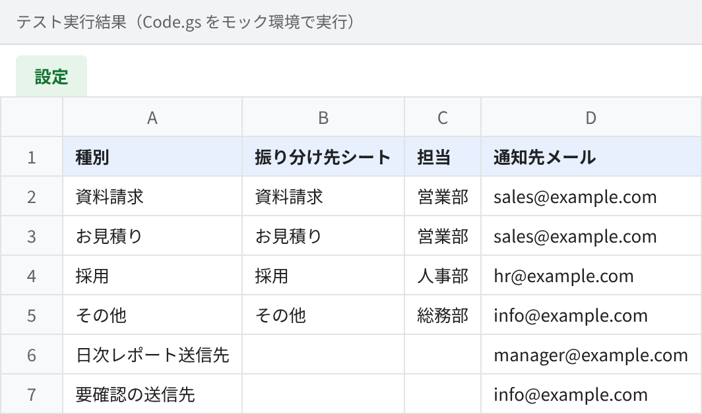
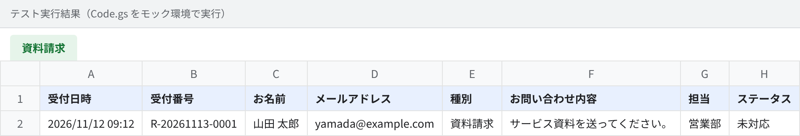
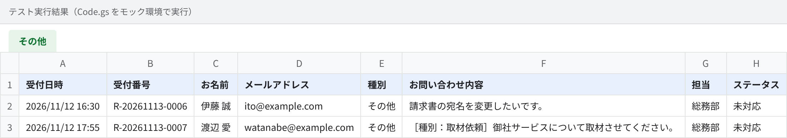
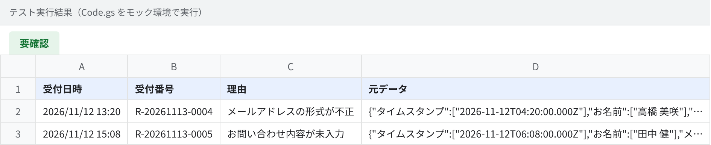
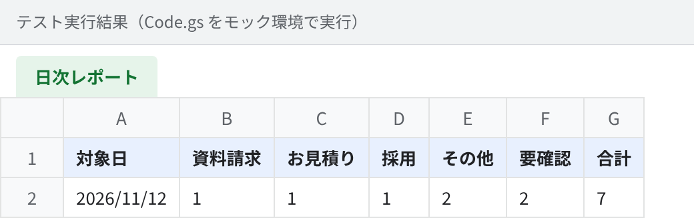

# フォーム回答の自動振り分け・通知・日次集計（Google Apps Script）

Googleフォームで受けた問い合わせを、**種別ごとのシートへ自動で振り分け、担当者に通知し、毎朝件数をレポート**する仕組みです。
コードを触らずに「設定」シートだけで振り分け先や通知先を変えられるので、導入後の運用を現場の方だけで回せます。

## 解決する課題

| よくある手作業 | この仕組みでは |
|---|---|
| フォームの回答シートを毎日見て、担当者ごとにコピーしている | 送信された瞬間に種別ごとのシートへ自動で振り分け |
| 誰がどの問い合わせを見るのか曖昧で、対応漏れが起きる | 種別ごとの担当者へ即時にメール通知。受付番号で追跡 |
| メールアドレスの入力ミスで返信できない問い合わせが埋もれる | 入力チェックで不備を検出し「要確認」シートへ分離して通知 |
| 毎朝、前日の件数を数えて上長に報告している | 毎朝8時に種別ごとの件数を集計し、シートへ記録してメール送信 |

## 処理の流れ

```
フォーム送信
   │
   ▼
onFormSubmit ── 入力チェック ──NG──▶「要確認」シート ＋ 通知
   │OK
   ▼
「設定」シートで振り分け先を決定（設定にない種別は「その他」へ）
   │
   ├─▶ 種別ごとのシートに追記（受付番号 R-yyyyMMdd-0001 を自動採番）
   ├─▶ 担当者へメール通知
   └─▶「処理ログ」に記録

毎朝8時 dailyReport ─▶ 前日分を集計 ─▶「日次レポート」に追記 ＋ メール送信
```

## 実行結果

コードをそのままテスト環境で動かし、7件の回答（正常4件・不備2件・設定にない種別1件）を処理した結果です。

**設定シート**（振り分け先・担当・通知先をここで管理）



**振り分け後のシート**（例：資料請求）



**設定にない種別は「その他」へ**。元の種別は内容の先頭に残すので、情報は失われません。



**不備のある回答は「要確認」へ分離**。理由と元データを残します。



**日次レポート**



## 工夫した点

- **同時送信でも受付番号が重複しない**：`LockService` で排他制御
- **トリガーの二重登録を防止**：`setup()` を何度実行しても安全
- **質問名のゆれに強い**：「お名前／氏名」「種別／お問い合わせ種別」などを吸収
- **エラーは処理ログに残す**：止まった原因を後から追える
- **テスト付き**：GASのサービスをNode.js上で再現し、振り分け・入力チェック・集計を自動テスト

## 導入手順

1. フォームの回答先スプレッドシートを開き、「拡張機能 → Apps Script」を選ぶ
2. `src/Code.gs` の内容を貼り付けて保存
3. 関数 `setup` を選んで実行し、表示される権限を許可（設定シートとトリガーが作られます）
4. 「設定」シートの振り分け先・担当・通知先メールを書き換える

フォームの質問は「お名前」「メールアドレス」「種別」「お問い合わせ内容」を想定しています。

## テストの実行

```bash
TZ=Asia/Tokyo node test/run-test.js
```

## カスタマイズ例

- 通知先をメールから Slack / Chatwork / LINE に変更
- 種別の判定を生成AI（ChatGPT・Claude・Gemini）で自動化し、自由記述からも振り分け
- 自動返信メール、対応期限を過ぎた問い合わせのリマインド
- 日次レポートをグラフ付きのスプレッドシートやPDFで送付
