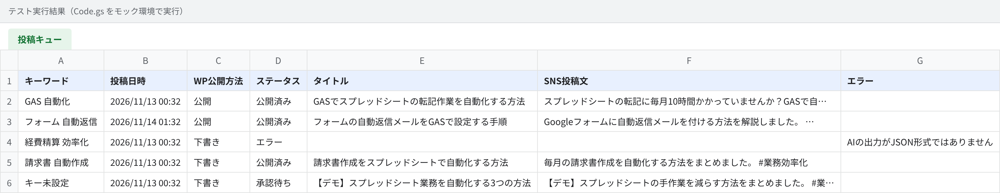
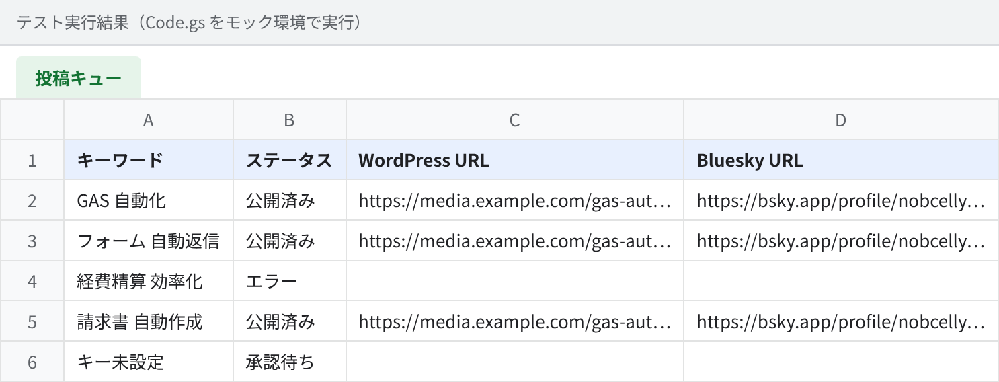
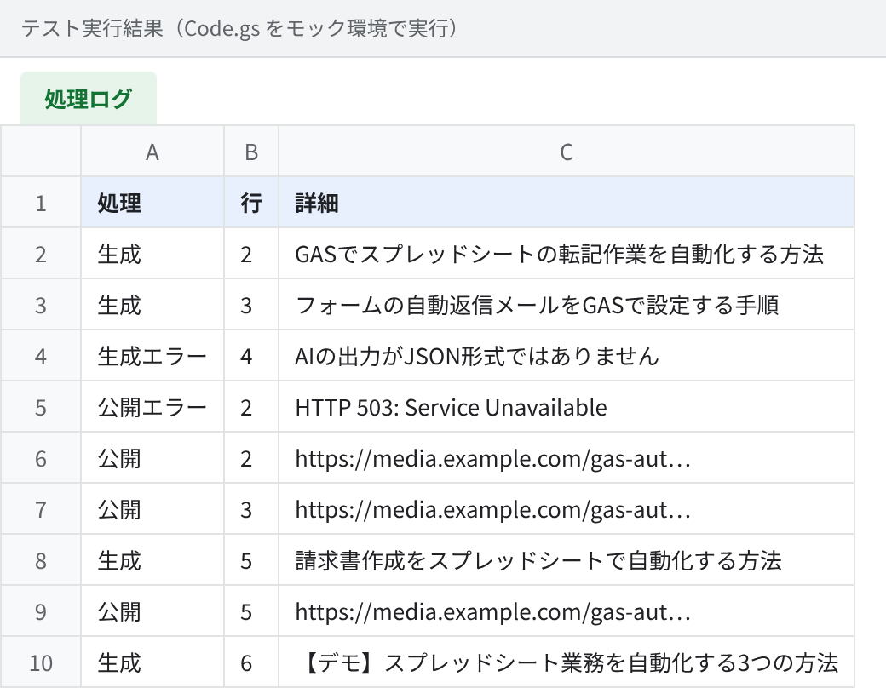

# 生成AIで記事・SNS投稿を作り、承認後に自動投稿（Google Apps Script）

スプレッドシートにキーワードを入れるだけで、**生成AIが記事とSNS投稿文を下書きし、人が承認したものだけをWordPressとBlueskyへ自動投稿**する仕組みです。
サーバーを用意せず、Googleスプレッドシートを管理画面として使うので、運用コストはほぼ生成AIのAPI料金だけです。

## 解決する課題

| よくある悩み | この仕組みでは |
|---|---|
| 記事を書いてWordPressに入稿し、SNSでも告知する作業が毎回手間 | 1行入力すれば、記事・メタ情報・SNS文まで一括で下書き |
| AIに任せると事実と違う内容がそのまま公開されそうで怖い | 「承認」にした行だけ公開。プロンプトでも根拠のない数字や固有名詞を禁止 |
| 投稿の途中でエラーが起きると、二重投稿や投稿漏れが起きる | 成功した投稿先のURLを先に保存し、再実行しても二重投稿しない |
| 特定のAIサービスに縛られたくない | OpenAI / Claude / Gemini を設定1つで切り替え |

## 処理の流れ

```
「投稿キュー」シート（キーワード・テーマ・参考メモ・投稿日時）
   │  ステータス：未生成
   ▼
generateDrafts（1時間ごと）
   └─ 生成AI → タイトル／メタディスクリプション／本文HTML／SNS投稿文
        ・出力をJSONで検証し、不正な出力はエラーで停止
        ・本文は許可したタグ以外を除去（script等の混入を防止）
   │  ステータス：承認待ち
   ▼
人が内容を確認して「承認」に変更
   ▼
publishApproved（15分ごと）
   ├─ WordPress REST API で公開／予約／下書き保存
   └─ Bluesky に記事URL付きで投稿（文字数上限に自動で収める）
   │  ステータス：公開済み（URLをシートに記録）
```

## 実行結果

外部サービスへの通信を差し替えたテスト環境で、コードをそのまま動かした結果です。
AIが不正な出力を返したケース、Blueskyが一時的に落ちていたケース、投稿日時が未来のケースも含めています。

**投稿キュー**（キーワードごとの生成結果とステータス）



**投稿先URLの記録**



**処理ログ**：Blueskyが503を返した記事は「公開エラー」になり、復旧後の再実行で公開。WordPressへは1回しか投稿していません。



## テストで確認していること

- AIの出力が ```json で囲まれていても取り出せる／JSONでなければエラーにして止める
- 本文から `<script>`・`onclick` など許可外のタグや属性を除去する
- 承認されていない記事・投稿日時前の記事は投稿しない
- WordPress：認証ヘッダー、サイトURL末尾のスラッシュの正規化、公開／予約／下書きの切り替え
- Bluesky：5xxは最大3回まで再試行、日本語を含む本文でもリンク位置（バイト単位）が正しい
- 途中で失敗して再実行しても、成功済みの投稿先へは二重投稿しない
- SNS投稿文を文字数上限（300字）に収め、末尾に記事URLを付ける
- OpenAI と Claude の切り替え／APIキー未設定時はデモ文で動作確認できる

```bash
TZ=Asia/Tokyo node test/run-test.js
```

## 導入手順

1. 新しいスプレッドシートで「拡張機能 → Apps Script」を開き、`src/Code.gs` を貼り付ける
2. 「プロジェクトの設定 → スクリプト プロパティ」に以下を登録

| プロパティ | 内容 |
|---|---|
| `AI_PROVIDER` | `openai` / `anthropic` / `gemini` |
| `AI_API_KEY` / `AI_MODEL` | 使う生成AIのAPIキーとモデル名 |
| `WP_SITE_URL` / `WP_USER` / `WP_APP_PASSWORD` | WordPressのURL、ユーザー名、アプリケーションパスワード |
| `BSKY_HANDLE` / `BSKY_APP_PASSWORD` | Blueskyのハンドルとアプリパスワード |

3. 関数 `setup` を実行し、権限を許可（シートとトリガーを作成）
4. 「投稿キュー」に行を追加（ステータスは「未生成」）

APIキーやパスワードはシートに書かず、スクリプト プロパティにだけ保存します。

## 月額費用の目安

- GAS・スプレッドシート・WordPress REST API・Bluesky API：0円
- 生成AI：1記事あたり数円〜数十円（モデルと文字数による）

## 拡張例

- X・Threads・LinkedIn・Instagramへの投稿追加
- アイキャッチ画像の自動生成とWordPressへのアップロード
- カテゴリー・タグ・内部リンク・問い合わせ導線の自動付与
- 既存記事のリライト、複数サイトの一括管理
