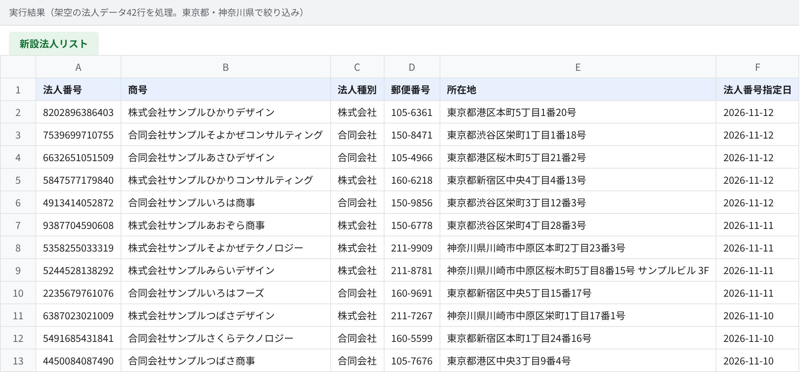
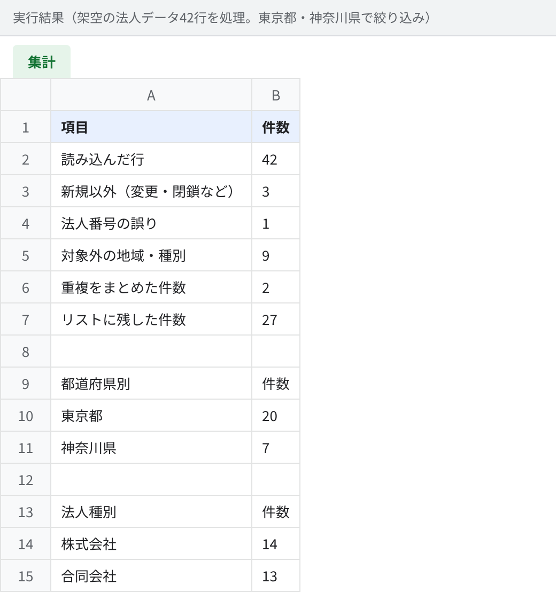

# 新設法人の営業リストを公開データから自動作成（Python）

国税庁「法人番号公表サイト」が毎日公開している**差分データ**から、新しく設立された法人だけを取り出し、
**表記を整え、重複と誤りを除いて、Excel／CSVの営業リストにする**ツールです。

Webサイトを1件ずつ巡回して集めるのではなく、国が公開している一次データを使うので、
法人番号・商号・所在地・設立日（法人番号指定日）を正確に、相手サイトに負荷をかけずに取得できます。

## 解決する課題

| よくある悩み | このツールでは |
|---|---|
| 新設法人の情報を毎日手で探して転記している | 差分データを読み込むだけで、地域・法人種別で絞ったリストを自動作成 |
| 全角・半角の混在や空白のゆれで、重複に気付けない | NFKC正規化で表記をそろえ、法人番号で重複を統合（更新日の新しい方を残す） |
| 入力ミスのある番号が紛れ込む | 法人番号のチェックデジットを検証し、誤りを除外 |
| 処理の中身が見えず、件数が合っているか分からない | 「読み込み → 除外理由ごとの件数 → 残した件数」を集計シートに記録 |

## 実行結果

架空の法人データ42行（表記ゆれ・重複・番号誤り・商号変更などを意図的に含む）を、東京都・神奈川県で絞り込んで処理した結果です。

```text
$ python -m company_list.cli diff_sample.zip --pref 東京都 神奈川県 -o out
読み込み 42行 → 新設法人 27社を出力しました（out）
  新規以外: 3
  番号誤り: 1
  対象外: 9
  重複: 2
```

**新設法人リスト**（Excel・CSVで出力。全角の番地や「　サンプルビル　３Ｆ」も半角にそろえています）



**集計シート**（除外した理由ごとの件数と、地域・種別の内訳）



## 使い方

```bash
pip install openpyxl
cd src

# 法人番号公表サイトからダウンロードした差分データ（ZIP/CSV）を指定
python -m company_list.cli path/to/diff_YYYYMMDD.zip --pref 東京都 大阪府 --kind 株式会社 合同会社 -o out

# 1週間分をまとめて処理することもできます
python -m company_list.cli diff_1106.zip diff_1107.zip diff_1108.zip -o out
```

URLを直接指定した場合は、リクエストの間隔を3秒以上空け、失敗時は2秒・4秒と待ってから再試行します。

## 構成

```
src/company_list/
  houjin.py   差分データの読み込み、新規の抽出、チェックデジット検証、正規化、重複統合
  fetch.py    取得（URL・ローカルファイル・ZIP対応、間隔調整と再試行）
  export.py   CSV（Excelで文字化けしないBOM付き）とExcel（見出し固定・フィルター・集計シート）
  cli.py      コマンドライン
tests/
  make_fixture.py        架空の法人でテストデータを生成
  test_company_list.py   pytest（8件）
```

## テスト

```bash
pip install openpyxl pytest
PYTHONPATH=src python -m pytest -q tests
```

- チェックデジット：国税庁自身の法人番号（7000012050002）で検証
- 正規化：全角数字・全角空白・郵便番号の整形
- 抽出：新規以外の除外、番号誤りの除外、重複統合（古い更新日を捨てる）、新しい順の並び
- 絞り込み：都道府県・法人種別
- 出力：BOM付きCSV、Excelのシート構成
- 取得：待機時間と再試行、規定回数での打ち切り

## 拡張例

- 日次の自動実行（Cloud Run Jobs・GitHub Actions・GAS）とGoogleスプレッドシートへの追記
- 公式サイトの検索APIによる特定と、生成AIでの業種分類・事業内容の要約
- 公式サイトに掲載された代表電話番号・問い合わせフォームURLの取得（各サイトの利用規約・robots.txtに従う）
- 前回までのリストとの差分だけを通知
