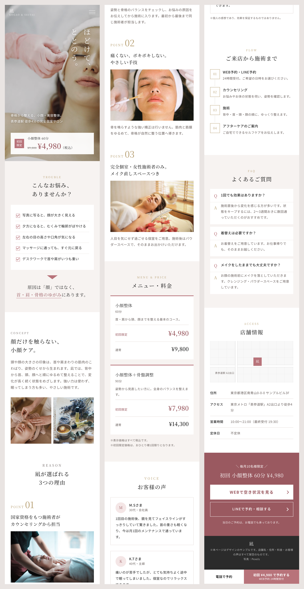
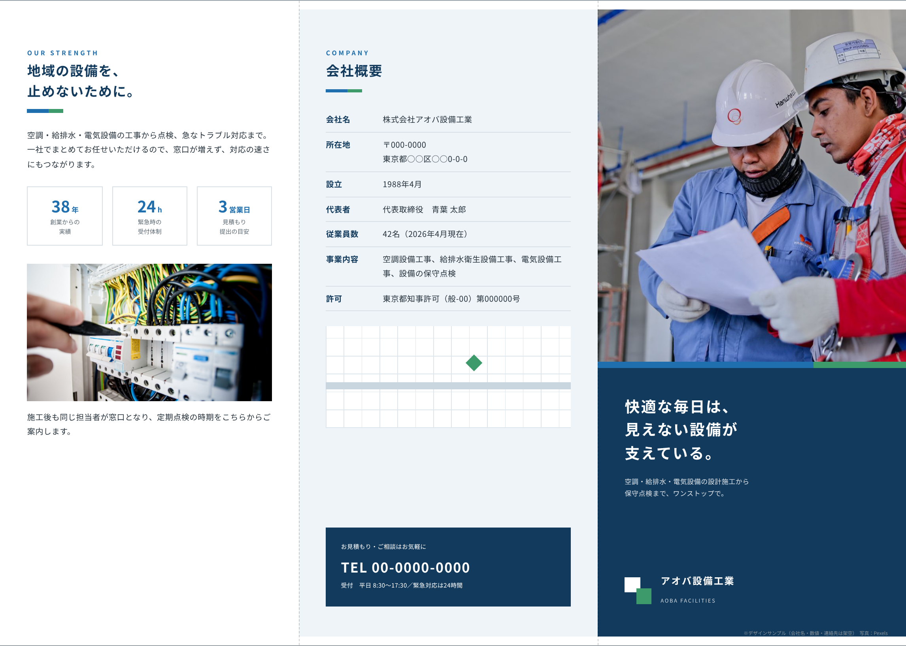
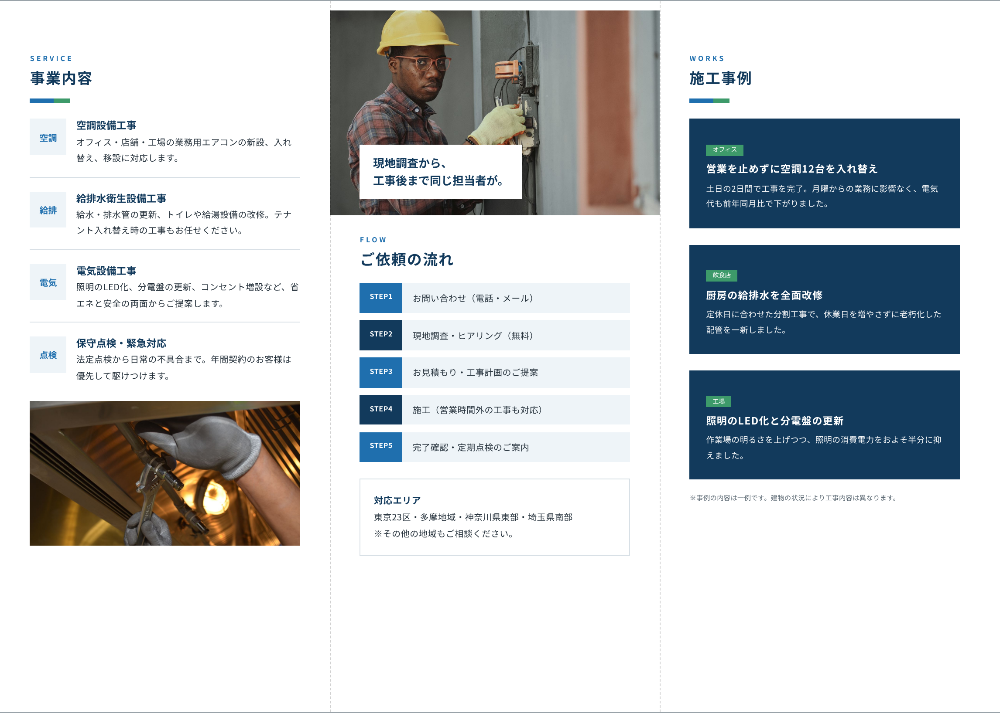
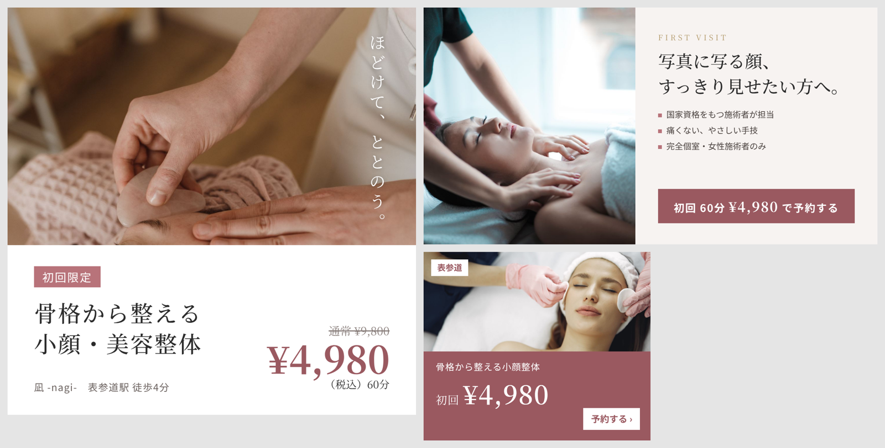

# デザインサンプル（LP・パンフレット・バナー）

自主制作のデザインサンプルです。店舗名・会社名・住所・料金・お客様の声などは、すべて架空のものです。写真は [Pexels](https://www.pexels.com/) のフリー素材を使っています。

## 1. 小顔・美容整体サロンのLP（スマートフォン向け）

集客用のランディングページです。「悩みの提示 → 原因 → 選ばれる理由 → 料金 → お客様の声 → 流れ → よくある質問 → 予約」の順に、予約まで迷わず進める構成にしています。画面下には予約ボタンを固定表示しています。

- ソース：[lp-salon/index.html](lp-salon/index.html)（HTML／CSS）
- 全体画像：[lp-salon/lp-full.png](lp-salon/lp-full.png)

## 2. 設備工事会社の会社案内（A4・三つ折り）

営業先に渡す会社案内です。表紙・事業内容・強み・ご依頼の流れ・施工事例・会社概要で構成しています。印刷用PDFは塗り足し3mmつきです。

- 印刷用PDF：[pamphlet-trifold/pamphlet.pdf](pamphlet-trifold/pamphlet.pdf)

## 3. 広告・SNSバナー

LPと同じサロンの集客用バナーです。Instagram（1080×1080）、SNS広告（1200×628）、ディスプレイ広告（300×250）の3サイズで、どのサイズでも価格と予約への導線がひと目で分かるようにしています。

